# Mermaid renderer gallery

## Gantt

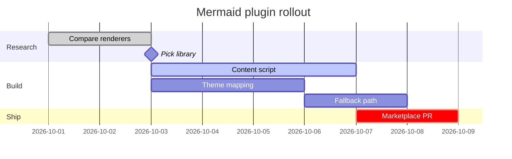


## Flowchart with subgraphs

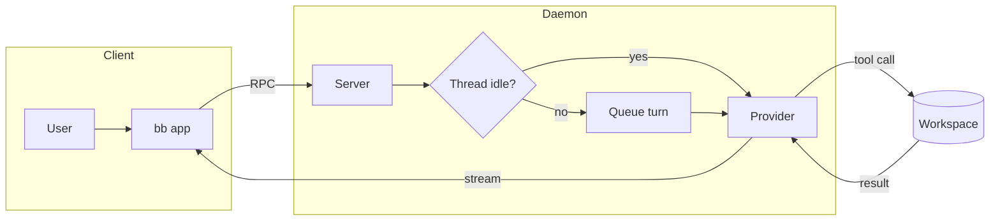


## Sequence

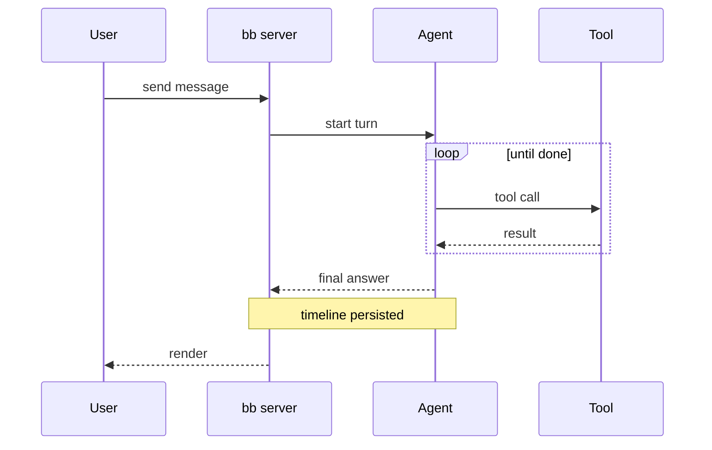


## State

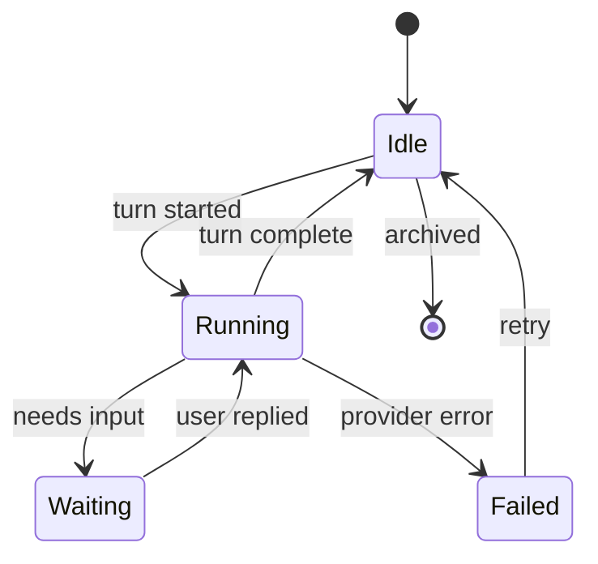


## Class

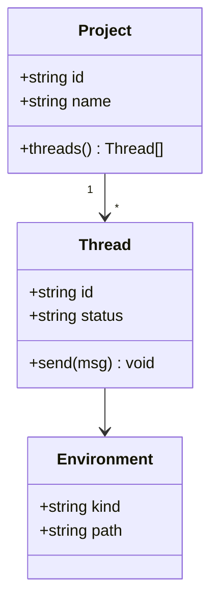


## ER (includes the }o--|| relation beautiful-mermaid drops)

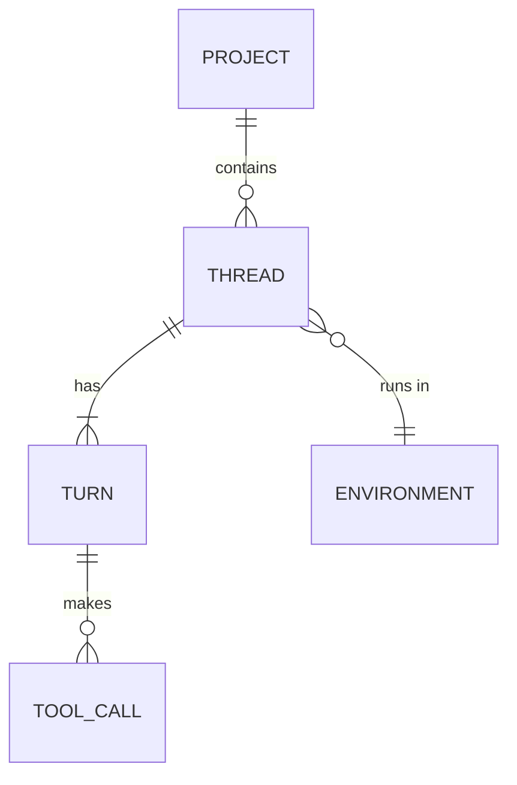


## Pie

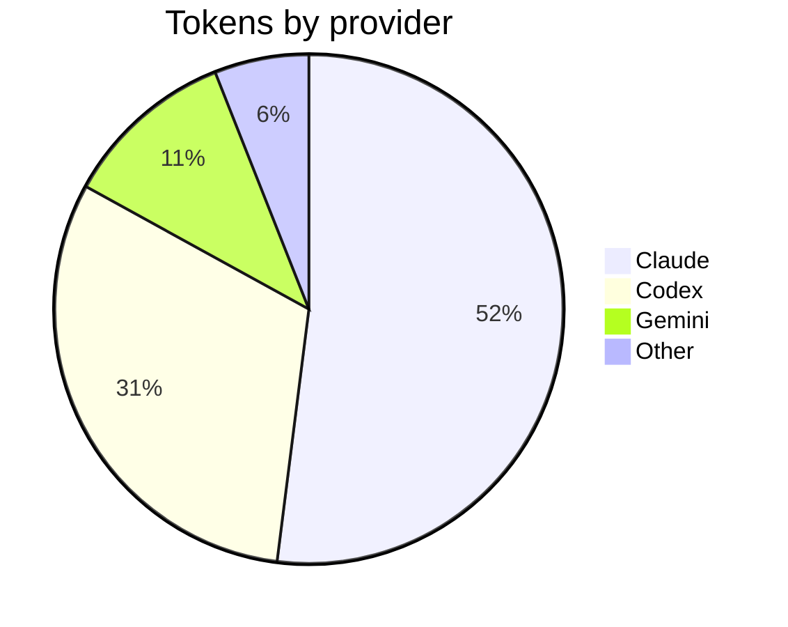


## Mindmap

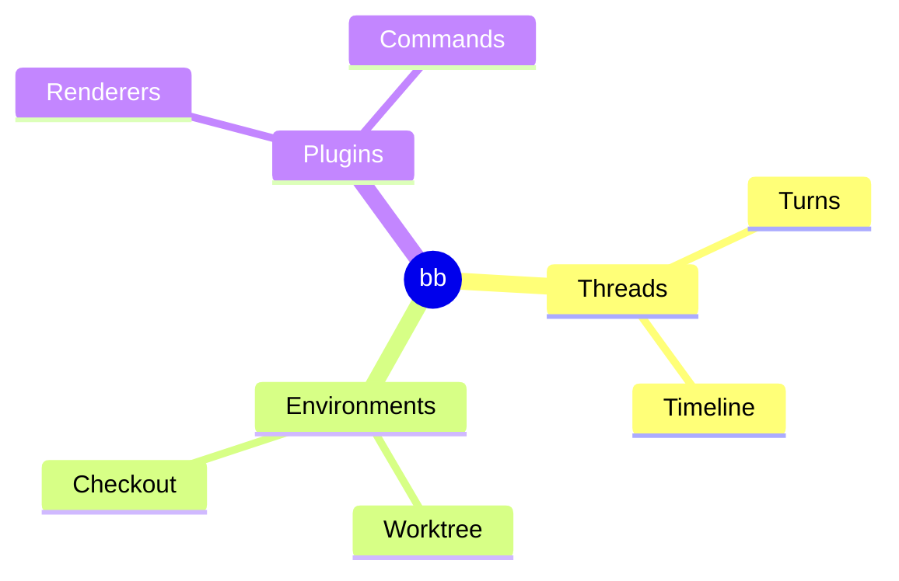


## Timeline

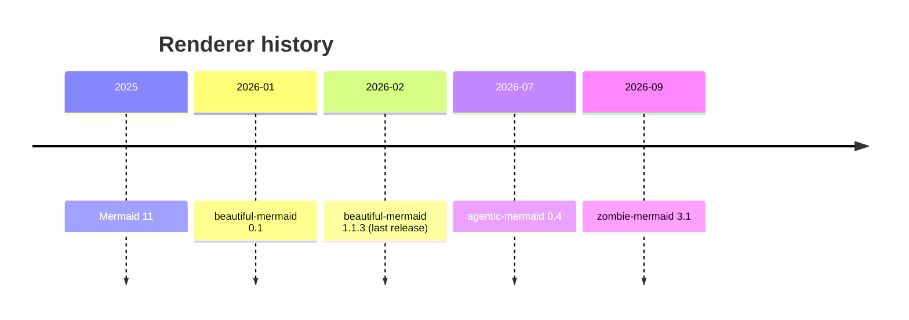


## User journey

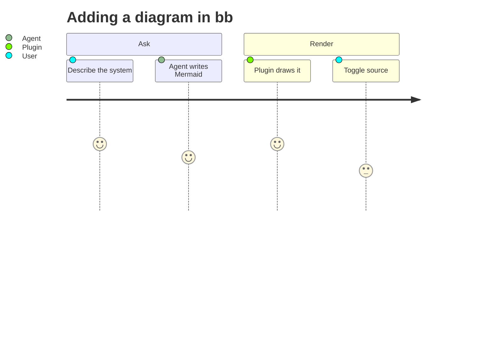


## Quadrant

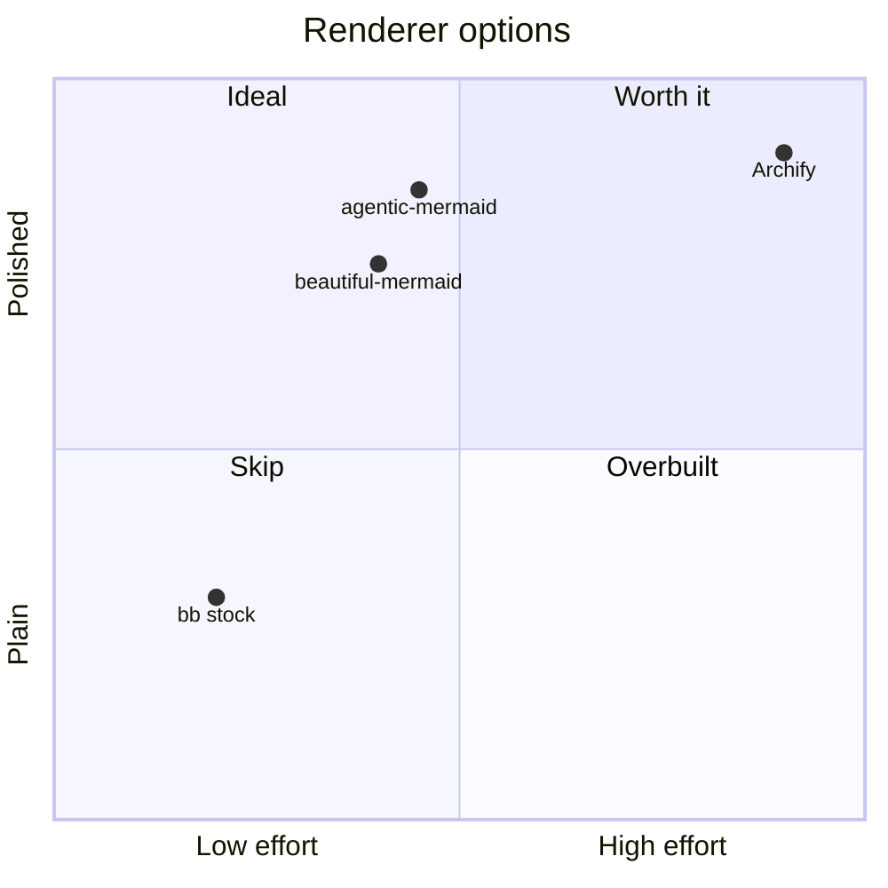


## XY chart

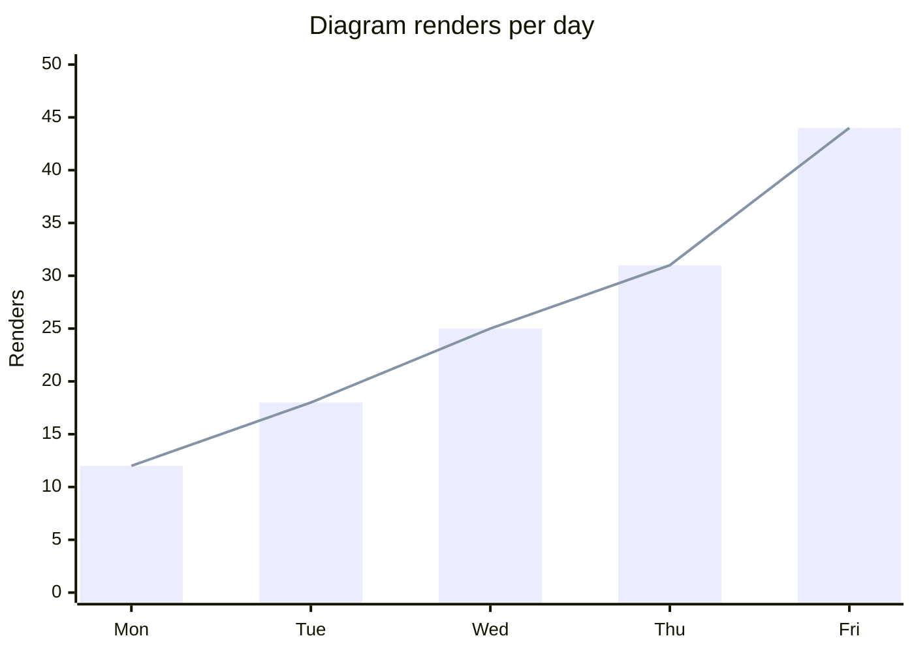


## Architecture

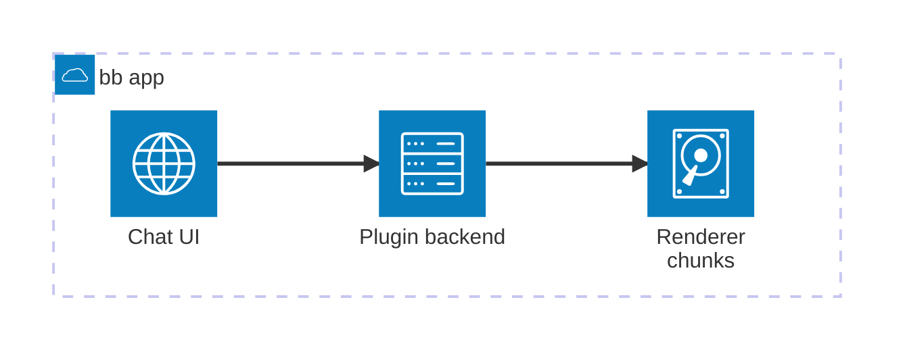


## Radar

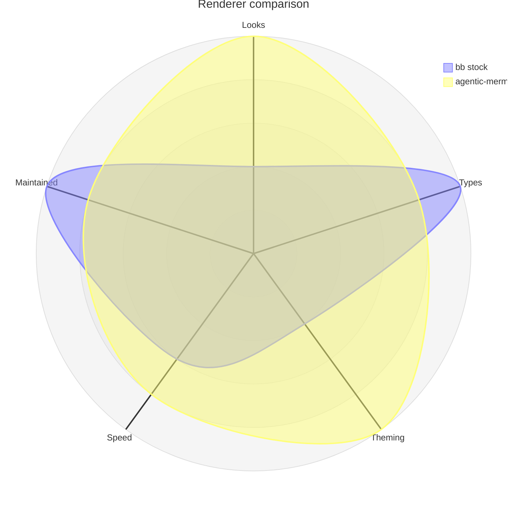


## Git graph

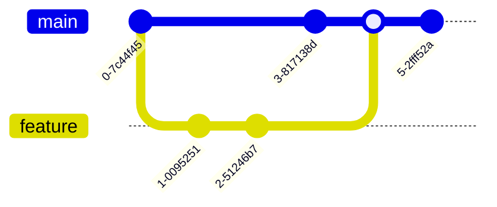


## Sankey (unsupported → stock)

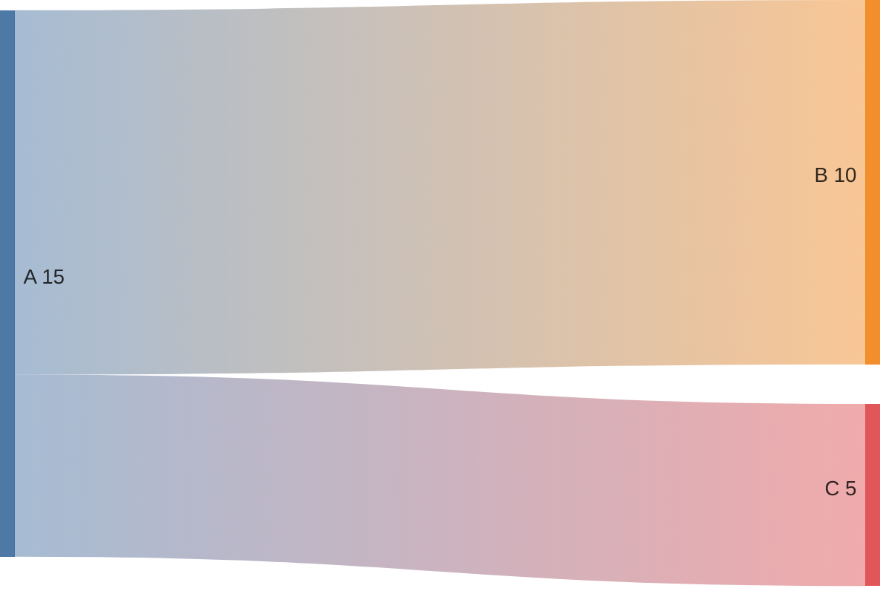


## Broken syntax (→ stock error state)

```mermaid
flowchart LR
  A-->
```


## Front matter + init directive

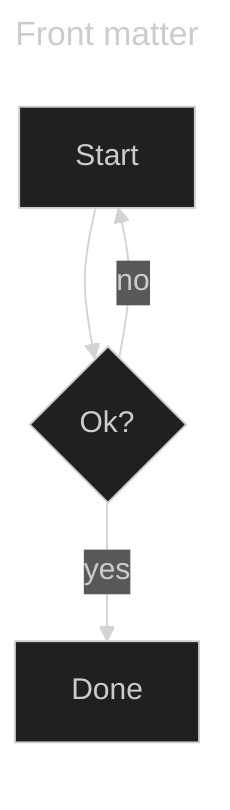
